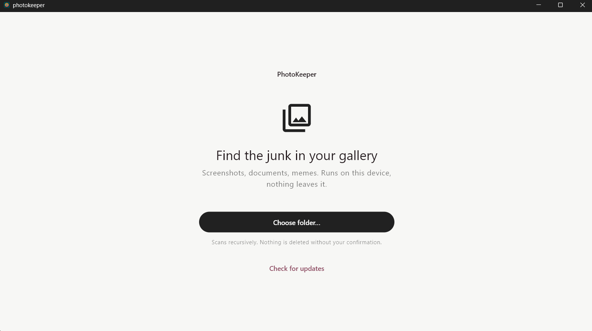
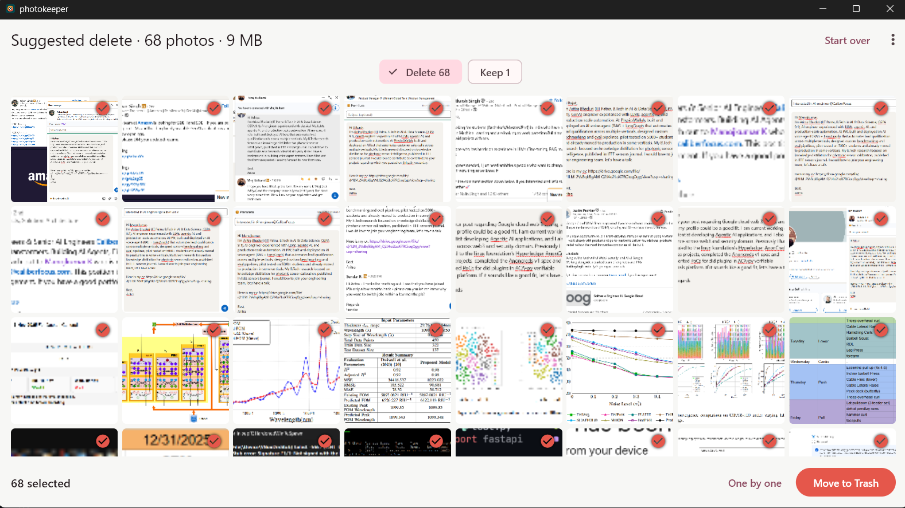

# Photokeeper

An extremely fast lightweight cross-platform gallery organizer. It uses the [Photokeeper-cli](https://github.com/aritroCoder/photokeeper-cli), a C++ cli implementation under the hood to work with your gallery photos locally. Nothing is shared over the internet. The UI is built with flutter for cross platform compatibility.

<table>
  <tr>
    <td width="50%"></td>
    <td width="50%"></td>
  </tr>
</table>

## Installation

The installation binaries bundles the entire cli and UI together for easy setup and install. Open the [release page](https://github.com/aritroCoder/photokeeper/releases) and expand **Assets** under the newest release to find the downloads.

- **Windows:** Download `photokeeper-windows-x64-setup.exe`, open it, and follow the installation steps. Open PhotoKeeper from the Start menu.
- **Mac (Apple silicon):** Download `photokeeper-macos-arm64.dmg`, open it, and drag PhotoKeeper into **Applications**. Open it from there.
- **Linux (Ubuntu):** Follow the [Ubuntu installation steps](#ubuntu) below to add PhotoKeeper to your app launcher. Other linux distros can use similar methods to install (ask an LLM to get the exact steps for your distro!).
- **Android:** Download `photokeeper-android-arm64.apk` on your phone, open it, and tap **Install**. If asked, allow your browser to install the app.
- **iPhone/iPad:** Installation needs a computer and a helper app such as AltStore or Sideloadly. Download `photokeeper-ios-unsigned.ipa` and follow the helper app's instructions.

### Ubuntu

For Ubuntu 24.04 or newer on an Intel or AMD computer:

1. Download `photokeeper-linux-x64.tar.gz` from the release page, right-click the download, and choose **Extract**.
2. Open the extracted `bundle` folder. Right-click an empty area inside it and choose **Open in Terminal**.
3. Copy and paste this whole block into the terminal and press **Enter**. It installs PhotoKeeper for your account and adds its app shortcut; no administrator password is needed.

   ```sh
   mkdir -p "$HOME/.local/opt/photokeeper" "$HOME/.local/share/applications"
   cp -a . "$HOME/.local/opt/photokeeper/"
   chmod +x "$HOME/.local/opt/photokeeper/photokeeper"
   cat > "$HOME/.local/share/applications/dev.photokeeper.photokeeper.desktop" <<EOF
   [Desktop Entry]
   Type=Application
   Name=PhotoKeeper
   Comment=Organize your photos
   Exec="$HOME/.local/opt/photokeeper/photokeeper"
   Icon=$HOME/.local/opt/photokeeper/data/app_icon.png
   Terminal=false
   Categories=Graphics;Photography;
   EOF
   ```

4. Open **Show Apps**, search for **PhotoKeeper**, and click its icon. Right-click the icon and choose **Pin to Dash** to keep it in the dock. If it does not appear immediately, log out and back in.

Photokeeper by default only checks your gallery for images in the mobile app, and can take folder selection for the desktop version only. You can now delete the download and extracted folder.

## Getting Updates
The app has a built in autoupdater that you can use to update your installation to the latest version, once a new release is published.

## Performance
Performance numbers and comparison to other alternatives are given in detail in the [Photokeeper-cli](https://github.com/aritroCoder/photokeeper-cli) readme. The performance numbers on the app for your specific devices can still vary, due to the hardware differences and UI overhead. Once a scan is done, you will get an option to check performance details of the last scan, which will show the exact performance numbers for your device.
